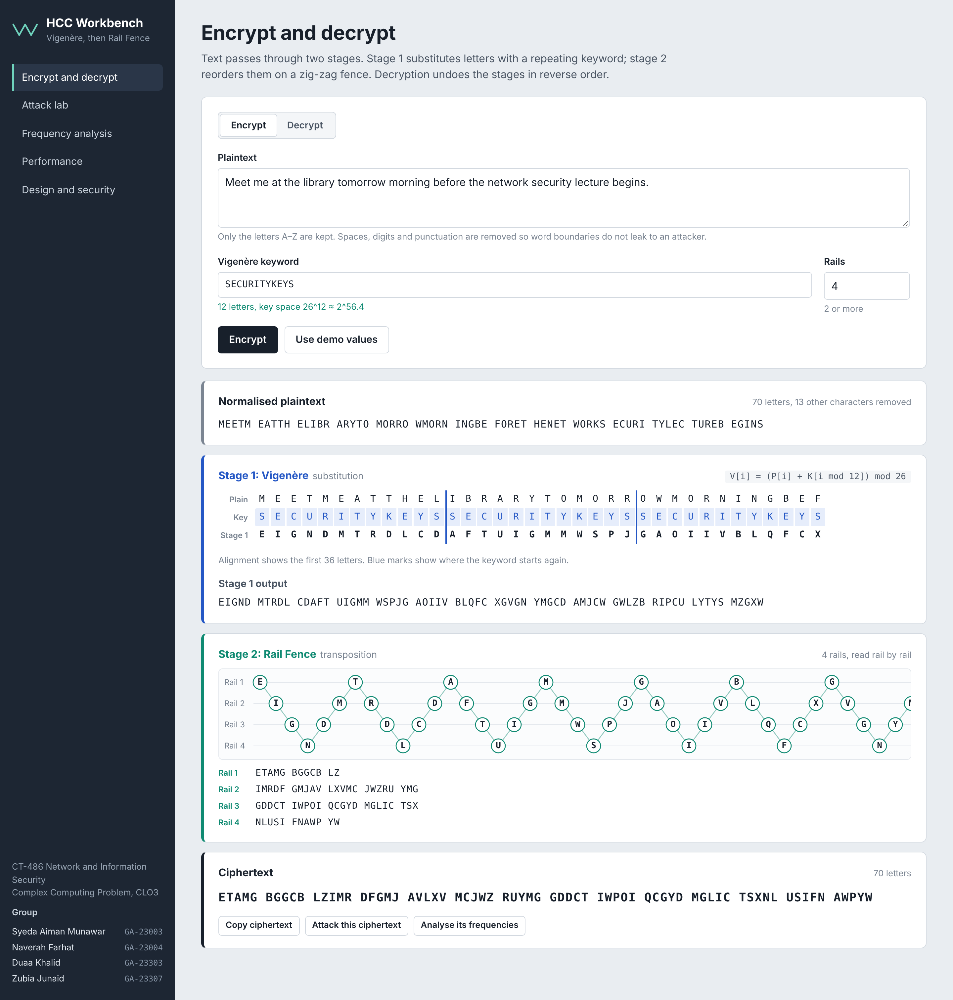
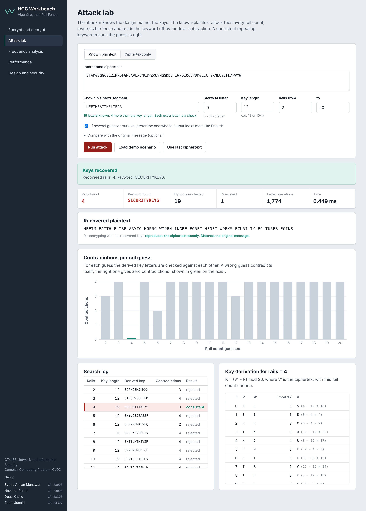
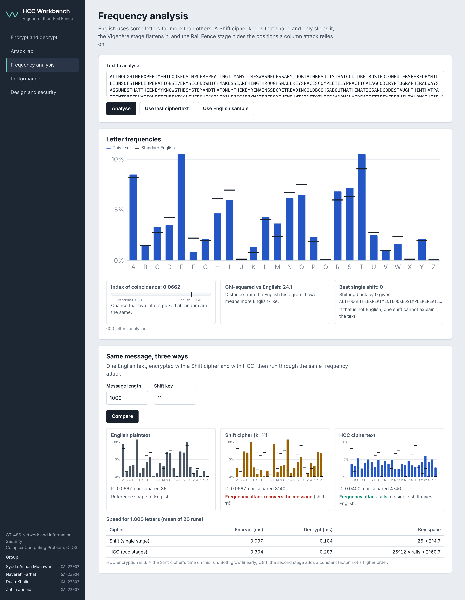
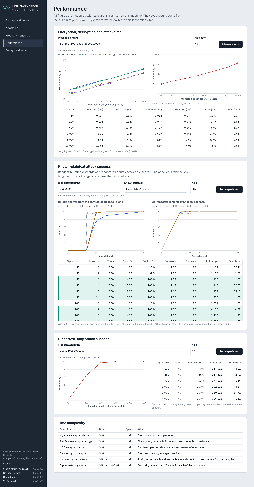

# HCC - Hybrid Classical Cipher

**Design and Break a Custom Cipher Based on Classical Techniques**
CT-486 Network and Information Security - Complex Computing Problem (CLO3)

> Repository description (for GitHub "About"):
> *Educational two-stage classical cipher (Vigenere + Rail Fence) in Python, with a known-plaintext attack, frequency analysis, benchmarks and a full report.*

HCC encrypts in two stages:

```
Plaintext -> Vigenere (keyword >= 10 letters) -> Rail Fence (>= 2 rails) -> Ciphertext
Ciphertext -> Rail Fence^-1 -> Vigenere^-1 -> Plaintext
```

> **Educational only.** HCC is deliberately breakable (that is the assignment). Never use it to protect real data.

## Group members

| Name | Roll No. |
|---|---|
| Syeda Aiman Munawar | GA-23003 |
| Naverah Farhat | GA-23004 |
| Duaa Khalid | GA-23303 |
| Zubia Junaid | GA-23307 |

Course advisor: Dr. Shariq Mahmood Khan - NED University of Engineering and Technology, Karachi.

## Web interface (HCC Workbench)

```bash
python app.py            # opens http://127.0.0.1:8000 in your browser
python app.py --port 8080
```

No extra packages are needed: the interface is served by Python's built-in `http.server`, and every
result in the browser is computed by the same modules the CLI and tests use (`app.py` exposes them as a
small JSON API; `ui/` holds the HTML, CSS and JavaScript).

| Section | What it shows |
|---|---|
| Encrypt and decrypt | Normalised input, Vigenere key alignment (stage 1), animated zig-zag rail fence diagram (stage 2), ciphertext; decryption shows the stages undone in reverse order. Live keyword validation (>= 10 letters, not periodic). |
| Attack lab | Known-plaintext attack with recovered rails and keyword, contradictions per rail guess chart, full search log, key derivation table `K = (V' - P) mod 26`, verification by re-encryption. Ciphertext-only attack with chi-squared score per rail guess. |
| Frequency analysis | Letter histogram against English, index of coincidence, chi-squared, best single shift; side-by-side English vs Shift vs HCC with the same frequency attack and timing. |
| Performance | Saved full-run results (timing, attack success vs ciphertext length and known-plaintext size, ciphertext-only success) as charts and tables, plus live re-runs; time-complexity table. |
| Design and security | How the stages are combined, security analysis and low-cost improvements. |

| | |
|---|---|
|  |  |
|  |  |

## Features

| Area | What you get |
|---|---|
| Cipher | Vigenere + Rail Fence, validated keys, any message length, A-Z normalization |
| Attack | Known-plaintext attack that **recovers** rails and keyword from (ciphertext, known segment, assumed key length, rail range); never receives the secret keys |
| Bonus attack | Ciphertext-only attack (per-column chi-squared + rail search) |
| Analysis | Letter frequencies, chi-squared, index of coincidence, Shift-cipher frequency attack |
| Experiments | Real timings (`time.perf_counter`), attack success rate and effort vs ciphertext length / known-plaintext size, CSV + PNG output |
| Interface | Browser UI (`python app.py`) and CLI menu (`python main.py`) |
| Quality | 57 unit tests, standard library only (matplotlib optional for graphs) |

## Project structure

```
HCC-Project/
├── app.py                 # web interface server + JSON API (python app.py)
├── ui/                    # index.html, styles.css, app.js for the web interface
├── main.py                # CLI menu (also: python main.py --demo)
├── utils.py               # alphabet, normalization, key validation
├── vigenere.py            # stage 1
├── rail_fence.py          # stage 2
├── hybrid_cipher.py       # HCC = stage 1 then stage 2 (and reverse)
├── shift_cipher.py        # single-stage baseline
├── attack.py              # known-plaintext attack (+ ciphertext-only bonus)
├── frequency_analysis.py  # frequencies, chi-squared, IC, Shift frequency attack
├── sample_data.py         # reproducible English-like test text and random keys
├── performance.py         # timing + attack-success experiments
├── requirements.txt
├── tests/                 # unittest suites
├── results/               # CSV + PNG produced by performance.py
├── docs/screenshots/      # screenshots of the web interface
└── report/                # report, viva Q&A, requirement checklist
```

## Installation and running

Requires Python 3.8 or newer (developed on 3.11).

```bash
python --version
pip install -r requirements.txt      # only matplotlib, optional
python app.py                        # web interface (recommended for the demo)
python main.py                       # interactive menu
python main.py --demo                # automatic walk-through of options 1-5 and 7
python -m unittest discover -s tests -v
python performance.py                # full experiments (about 1 minute), writes results/
python performance.py --quick        # fast version
```

### VS Code
1. *File -> Open Folder...* and choose `HCC-Project`.
2. Install the Microsoft **Python** extension, then *Ctrl+Shift+P -> Python: Select Interpreter*.
3. Open `main.py` and press the **Run** triangle, or open *Terminal -> New Terminal* and run `python main.py`.
4. For tests: *Testing* sidebar -> configure `unittest`, directory `tests`, pattern `test_*.py`.

## Testing every menu option

| Option | Try this |
|---|---|
| 1 Encrypt | Press Enter at every prompt to use the demo message, keyword `SECURITYKEYS`, 4 rails. Then try an invalid keyword like `SHORT` or rails `1` to see validation. |
| 2 Decrypt | Press Enter at every prompt: it decrypts the ciphertext created in option 1 (session memory). Try a wrong rail count to see garbage. |
| 3 Attack | Choose `a`, press Enter for all prompts -> attack succeeds with the log and calculations. Re-run with known length `8` (insufficient), with rail maximum `3` (secret rails outside the range), or with the exact key length `12` (ambiguous, resolved by English-likeness). `b` = your own ciphertext, `c` = ciphertext-only attack. |
| 4 Frequency | Choice 2 shows English vs Shift vs HCC statistics and why frequency analysis fails on HCC. |
| 5 Compare | Enter a length (default 1000) to time HCC against Shift and see the frequency attack break only Shift. |
| 6 Performance | `1` quick, `2` full (saves `results/*.csv, *.png`). |
| 7 Info | Prints architecture, complexity, security summary. |
| 8 Exit | Quits. |

## Input handling

Letters are upper-cased; spaces, digits, punctuation and every non A-Z character are **removed**. Decryption therefore returns the *normalized* plaintext (e.g. `MEETMEATNINE`). Formatting is not preserved on purpose, because word boundaries leak structure to an attacker.

## Demonstrating the attack (60-second script for the viva)

1. `python main.py`, option **1**, press Enter x3 -> note the ciphertext.
2. Option **3 -> a**, press Enter at every prompt -> the search log shows every rail count; only `rails=4` is `CONSISTENT`; the table shows `key = (V' - P) mod 26` spelling `SECURITYKEYS`.
3. Run again with known length `8` -> *INSUFFICIENT KNOWN PLAINTEXT*: the attack honestly reports failure.

## Documentation

* `report/HCC_Report.md` - full academic report (25 sections, Mermaid flowcharts)
* `report/Viva_Questions.md` - 25 viva questions with answers
* `report/Requirements_Checklist.md` - requirement -> implementation mapping

## Uploading to GitHub

```bash
cd HCC-Project
git init
git add .
git commit -m "HCC hybrid classical cipher: implementation, attack, tests, report"
git branch -M main
# create an EMPTY repository named HCC-Project on github.com, then:
git remote add origin https://github.com/<your-username>/HCC-Project.git
git push -u origin main
```

`__pycache__/` is already in `.gitignore`. After pushing, open the repository page and check that the screenshots render in this README.

Tip: set the repository *Description* and *Topics* (`cryptography`, `classical-ciphers`, `vigenere`, `rail-fence`, `python`, `cryptanalysis`).

## License / academic note

Coursework for CT-486. Original implementation; references are listed in the report.
