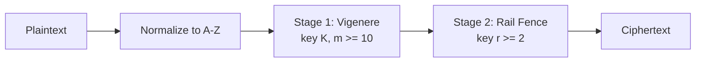
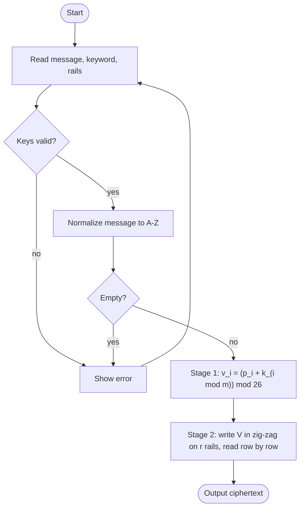
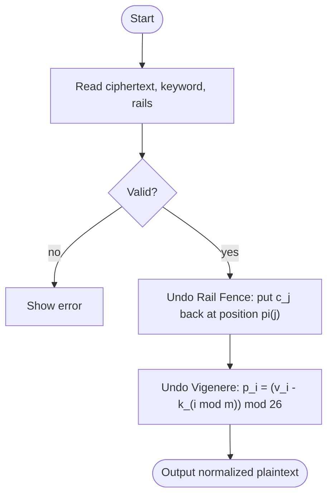

# 1. Title Page

**Design and Break a Custom Cipher Based on Classical Techniques**
**HCC - Hybrid Classical Cipher (Vigenere + Rail Fence)**

Course: CT-486 Network and Information Security - Complex Computing Problem (CLO3)
Student name / ID: ______________________  Section: ________
Instructor: ______________________  Date: ______________________
Source code: `https://github.com/SyedaAiman-123/HCC-Project`

---

# 2. Abstract

This report presents HCC, a two-stage classical cipher that applies a Vigenere substitution (keyword of 12 letters) followed by a Rail Fence transposition (configurable rails). The cipher is implemented in Python with input validation, a command-line interface and 52 unit tests. A known-plaintext attack is implemented that does not receive the secret keys: it searches the rail-count range, reverses the transposition for each guess, derives the Vigenere key letters by modular subtraction and accepts a guess only if the derived letters form a consistent repeating keyword. Measured over 200 random trials per setting, the attack's final answer was correct in 100% of trials once the known segment exceeded the key length by one letter or more (k >= 13, using an English-likeness tie-break), and the stricter unique-survivor test succeeded in 100% of trials for k >= 16 and n >= 100 (90% at n = 50), at a cost of roughly 19 x n character operations, i.e. milliseconds. Encryption and decryption are O(n) and about 2-3.7x slower than a Shift cipher in our measurements. A frequency-analysis module and a bonus ciphertext-only attack show that flattening letter frequencies is not security. The report concludes that HCC is a good teaching design but offers no protection against modern cryptanalysis, and suggests inexpensive improvements.

# 3. Introduction

Before modern ciphers, secrecy relied on two basic operations: **substitution** (replace symbols) and **transposition** (reorder symbols). Claude Shannon later called these *confusion* and *diffusion*; modern block ciphers still combine them in many rounds. This project studies the idea in its simplest form by combining one classical substitution cipher and one classical transposition cipher, and then, as the assignment demands, by breaking the result.

# 4. Problem Statement

Design a custom cipher from at least two classical techniques with at least two stages and a key of at least 10 characters; implement encryption and decryption for A-Z messages of any length; attack it with frequency analysis and/or known plaintext; measure attack success and effort for different ciphertext lengths; analyse time complexity; compare with a single-stage cipher; and propose cheap security improvements.

# 5. Project Objectives

1. Design and justify a two-stage cipher (substitution then transposition).
2. Implement correct encryption/decryption with strict validation and tests.
3. Implement a realistic known-plaintext attack that really recovers the key.
4. Implement frequency analysis and explain why it alone fails on Vigenere-based output.
5. Measure (not assume) running times and attack success rates.
6. Analyse complexity, compare with the Shift cipher, and discuss limitations and improvements.

# 6. Background of Classical Cryptography

Classical ciphers operate on letters by hand-computable rules. They fall into three families: **monoalphabetic substitution** (Caesar/Shift, affine; one fixed mapping, broken by letter-frequency analysis), **polyalphabetic substitution** (Vigenere; several mappings used in rotation, which hides single-letter frequencies) and **transposition** (Rail Fence, columnar; letters keep their identity but change position). Kerckhoffs' principle (1883) states that a cipher must stay secure when everything except the key is public; all attacks in this report therefore assume the attacker knows the algorithm. Attack models used here: **ciphertext-only** (attacker has only C) and **known-plaintext** (attacker also knows part of P). See [Stallings], [Menezes], [Kahn].

# 7. Explanation of the Selected Ciphers

## 7.1 Vigenere cipher (Stage 1)
Letters are numbers A=0..Z=25. With keyword K of length m: `C[i] = (P[i] + K[i mod m]) mod 26`, `P[i] = (C[i] - K[i mod m]) mod 26`. The same plaintext letter is encrypted with up to m different shifts, so the ciphertext histogram is flatter than English. *Strength:* defeats simple frequency analysis; key space 26^m. *Weakness:* the key repeats, so every m-th letter is a Shift cipher; Kasiski examination / index of coincidence reveal m and each column is then solved by frequency analysis.

## 7.2 Rail Fence cipher (Stage 2)
Write the text in a zig-zag over r rows and read row by row. With r = 4 and 26 letters the pattern is the one shown in Section 16. It is a fixed permutation of positions determined only by (n, r); letters are unchanged, so frequencies are preserved. *Strength:* destroys the positional structure used by Kasiski/IC attacks. *Weakness:* only about n-1 possible keys; trivially searched.

## 7.3 Why these two
They are the standard textbook representatives of the two families, are easy to implement and verify by hand, and are *complementary*: the substitution stage hides which letters occur, the transposition stage hides where the key repeats. Their different weaknesses make the attack design interesting.

# 8. Proposed HCC Architecture



* **Secret key** = (keyword K of >= 10 letters, rails r >= 2).
* Keyword rules (enforced by `validate_keyword`): letters only, length >= 10, and not a repetition of a shorter word (otherwise the *effective* key length would be below 10). Example demonstration key: `SECURITYKEYS` (12 letters), r = 4.
* **Design corrections made before implementation:** (a) the effective-length rule above (`AAAAAAAAAAAA` has 12 characters but only one distinct shift); (b) rails >= message length makes Stage 2 the identity - allowed but a warning is shown; (c) a known-plaintext segment of exactly m letters carries no redundancy, so the attack needs k > m to be reliable (Section 13).

# 9. Mathematical Formulation

Let P = (p_0..p_{n-1}), p_i in Z_26. Let K = (k_0..k_{m-1}). Let pi_r be the Rail Fence permutation of {0..n-1}: the position read off j-th in the row-by-row order, i.e. `C[j] = V[pi_r(j)]`.

* Stage 1: `v_i = (p_i + k_{i mod m}) mod 26`
* Stage 2: `c_j = v_{pi_r(j)}`
* Decryption: `v_{pi_r(j)} = c_j` (invert the permutation), then `p_i = (v_i - k_{i mod m}) mod 26`.

Rail of position i: with cycle length L = 2(r-1), `t = i mod L`, `rail(i) = t` if `t < r` else `L - t`. pi_r lists positions sorted by (rail, position). Decryption is correct because the composition (Vigenere^-1 after RailFence^-1 after RailFence after Vigenere) is the identity: each stage is a bijection and is undone in reverse order. Key space: 26^12 ~ 9.54 x 10^16 (~2^56.4) keywords times about n rail counts.

# 10. Encryption Algorithm

```
ALGORITHM HCC-Encrypt(message, keyword, rails)
  keyword <- validate(keyword)         # letters, len >= 10, not periodic
  rails   <- validate(rails)           # integer >= 2
  P <- uppercase(message) with all non A-Z removed ; fail if P is empty
  FOR i FROM 0 TO n-1:  V[i] <- (P[i] + K[i mod m]) mod 26          # Stage 1
  FOR i FROM 0 TO n-1:  rail[i] <- zigzag(i, rails)                 # Stage 2
  C <- letters of V grouped by rail 0, 1, ..., rails-1 (left to right inside a rail)
  RETURN C
```



# 11. Decryption Algorithm

```
ALGORITHM HCC-Decrypt(ciphertext, keyword, rails)
  validate keys; C <- normalize(ciphertext)
  order <- positions in rail-by-rail reading order (same permutation as encryption)
  FOR j FROM 0 TO n-1:  V[order[j]] <- C[j]                         # undo Stage 2
  FOR i FROM 0 TO n-1:  P[i] <- (V[i] - K[i mod m]) mod 26          # undo Stage 1
  RETURN P
```



Stages are undone in **reverse** order because the last operation applied (Rail Fence) must be removed first; applying Vigenere^-1 to the transposed text would subtract key letters from the wrong positions.

# 12. Attack Methodology

**Threat model.**

| Assumed known to the attacker | Must be recovered |
|---|---|
| Algorithm (Vigenere then Rail Fence) | Rail count r |
| Full ciphertext C (length n) | Keyword K |
| Known plaintext segment P_known, length k, and its offset s | The rest of the plaintext |
| Keyword length m (or a small range) | |
| Range of possible rail counts [r_min, r_max] | |

The attack function `known_plaintext_attack(ciphertext, known_plaintext, key_lengths, rail_range, known_offset, use_language_model)` has no parameter for the secret keys (checked by a unit test). The known segment is contiguous in the *plaintext* but is scattered in the *ciphertext* after the transposition, so the attacker needs the whole ciphertext, not just the matching piece.

**Idea.** For the correct r, undoing Rail Fence yields exactly the Vigenere output V; then `k_{i mod m} = (v_i - p_i) mod 26` for each known i, and equal residues i mod m must give equal letters. For a wrong r the recovered text V' is a scrambled copy of V and equal residues agree only by chance.

**Probability analysis.** Let rho = k - min(k, m) be the number of *redundant* equations. A wrong r passes the consistency test with probability about 26^(-rho). Expected number of surviving hypotheses = 1 + (R-1) x 26^(-rho), where R is the number of rail counts tested. For R = 19: rho = 0 -> 19 survivors (nothing can be decided); rho = 1 -> 1.69; rho = 2 -> 1.03. Our measurements agree (Section 18: 19.00, ~1.7-1.8, ~1.03). If k < m only k key letters are determined and the key cannot be fully recovered.

**Tie-breaking.** If several hypotheses survive, the optional language model ranks the fully-determined ones by the chi-squared distance of the *decrypted whole message* from English. This uses a stated extra assumption (English plaintext). The results table reports success both without it (strict) and with it (ranked).

# 13. Known-Plaintext Attack Algorithm

```
ALGORITHM KPA(C, P_known, M, [r_min, r_max], s)
  FOR r FROM r_min TO r_max:                       # step 1: guess rails
      V' <- inverse RailFence_r(C)                 # step 2: undo transposition       O(n)
      FOR EACH assumed key length m IN M:
          slots[0..m-1] <- empty ; conflicts <- 0
          FOR t FROM 0 TO k-1:
              i <- s + t ; d <- (V'[i] - P_known[t]) mod 26      # step 3: key letter
              IF slots[i mod m] empty: slots[i mod m] <- d
              ELSE IF slots[i mod m] != d: conflicts++          # step 4: consistency
          IF conflicts = 0: add (r, m, slots) to SURVIVORS
  IF SURVIVORS empty: report FAILURE (wrong assumptions or wrong known text)
  rank SURVIVORS: complete keys first, then by English-likeness of full decryption
  best <- first                                               # step 5: identify the candidate
  IF best has unknown key positions: report PARTIAL
  P <- Vigenere^-1(RailFence_best.r^-1(C), best.key)          # step 6: decrypt everything
  verify: HCC-Encrypt(P, best.key, best.r) = C                # end-to-end sanity check
  compare with original (only possible in the simulation)     # step 7
```

*Complexity:* O(R x (n + k x |M|)) plus O(n) per survivor for ranking. *Effort counters* (candidates tested, character operations, wall time) are reported by every run. The verification in step 6 is a consistency check of the implementation; the real discrimination is done by steps 4-5.

# 14. Frequency Analysis

`frequency_analysis.py` provides letter counts, relative frequencies, a chi-squared distance from standard English (Lewand), and the index of coincidence IC = sum n_i(n_i-1) / (N(N-1)). English IC ~ 0.0655, random letters ~ 0.0385.

**Why frequency analysis alone fails against HCC.** (1) A Shift cipher maps each letter to one letter, so the histogram is merely rotated and 26 trials of chi-squared find the key. (2) Vigenere maps a letter to up to m different letters, so the histogram flattens (measured IC of an HCC ciphertext: 0.0400 vs 0.0667 for the plaintext) and no single shift makes it look like English. (3) Rail Fence leaves the histogram unchanged but hides the positions (i mod m) needed to split the text into Shift-cipher columns. **Caveat:** this only defeats the *naive* attack. Searching the rail count and then analysing each of the m columns separately (the bonus `ciphertext_only_attack`) breaks HCC when the ciphertext is long enough (Section 18.3).

# 15. Implementation Details

| File | Role |
|---|---|
| `utils.py` | alphabet, normalization, `validate_keyword`, `validate_rails`, `ValidationError` |
| `vigenere.py`, `rail_fence.py`, `shift_cipher.py` | the three ciphers |
| `hybrid_cipher.py` | HCC pipeline and decryption in reverse order, with trace variants for demos |
| `attack.py` | known-plaintext attack, derivation table, ciphertext-only attack |
| `frequency_analysis.py` | statistics and Shift frequency attack |
| `sample_data.py` | original English sentence corpus, seeded generators |
| `performance.py` | timing and attack-success experiments, CSV/PNG output |
| `main.py` | menu-driven CLI and `--demo` mode |
| `tests/` | 52 `unittest` tests |

Key decisions: (a) Rail Fence is implemented as an explicit permutation `rail_order(n, r)` computed in O(n) with buckets, so encryption, decryption and the attack share one verified routine. (b) Input is normalized to A-Z and non-letters removed, consistently everywhere; formatting is not restored because spaces/punctuation would leak word boundaries. (c) Only the standard library is needed (matplotlib is optional for graphs). (d) Experiments use seeded `random.Random` objects so they are repeatable.

# 16. Sample Encryption and Decryption Walkthrough

Plaintext `MEETMEATTHELIBRARYTOMORROW` (n = 26), keyword `SECURITYKEYS` (m = 12), r = 4.

**Stage 1** - numbers A=0..Z=25:

| i | 0 | 1 | 2 | 3 | 4 | 5 |
|---|---|---|---|---|---|---|
| P | M(12) | E(4) | E(4) | T(19) | M(12) | E(4) |
| K | S(18) | E(4) | C(2) | U(20) | R(17) | I(8) |
| P+K mod 26 | 30 mod 26 = 4 -> E | 8 -> I | 6 -> G | 39 mod 26 = 13 -> N | 29 mod 26 = 3 -> D | 12 -> M |

Whole Stage 1 output: `EIGNDMTRDLCDAFTUIGMMWSPJGA`.

**Stage 2** - write it on 4 rails:

```
E . . . . . T . . . . . A . . . . . M . . . . . G .
. I . . . M . R . . . D . F . . . G . M . . . J . A
. . G . D . . . D . C . . . T . I . . . W . P . . .
. . . N . . . . . L . . . . . U . . . . . S . . . .
```

Reading the rails in order: `ETAMG` + `IMRDFGMJA` + `GDDCTIWP` + `NLUS` = **ETAMGIMRDFGMJAGDDCTIWPNLUS**.

**Decryption:** write the 26 ciphertext letters back into the same zig-zag slots (rail 0 gets the first 5, rail 1 the next 9, rail 2 the next 8, rail 3 the last 4), read the zig-zag to recover `EIGNDM...`, then subtract the key: `(4 - 18) mod 26 = 12 -> M`, `(8 - 4) = 4 -> E`, ... giving `MEETMEATTHELIBRARYTOMORROW`.

# 17. Attack Demonstration with Intermediate Calculations

Attacker knows: the ciphertext above, the first k = 16 plaintext letters `MEETMEATTHELIBRA` (offset 0), m = 12, rails in 2..8. Real output of `known_plaintext_attack`:

| Guess r | Key derived from known segment (key') | Conflicts among the 4 redundant letters | Verdict |
|---|---|---|---|
| 2 | SWPNOZMKNVEI | 4 | rejected |
| 3 | SNSKHBPNHFJY | 4 | rejected |
| **4** | **SECURITYKEYS** | **0** | **consistent** |
| 5 | SCIJZPJPAFWX | 4 | rejected |
| 6 | SIZHHHINMZPX | 4 | rejected |
| 7 | SIZQRSUWJTBV | 4 | rejected |
| 8 | SWEKXZWBWVWU | 4 | rejected |

Detailed derivation for r = 4 (after undoing Rail Fence, V' = `EIGNDMTRDLCDAFTU...`), key letter = (V'[i] - P[i]) mod 26:

| i | P | V' | (V'-P) mod 26 | key letter | slot i mod 12 |
|---|---|---|---|---|---|
| 0 | M | E | (4-12) mod 26 = 18 | S | 0 |
| 1 | E | I | (8-4) = 4 | E | 1 |
| 2 | E | G | (6-4) = 2 | C | 2 |
| 3 | T | N | (13-19) mod 26 = 20 | U | 3 |
| ... | | | | ... | ... |
| 11 | L | D | (3-11) mod 26 = 18 | S | 11 |
| 12 | I | A | (0-8) mod 26 = 18 | **S** (= slot 0) | 0 |
| 13 | B | F | (5-1) = 4 | **E** (= slot 1) | 1 |
| 14 | R | T | (19-17) = 2 | **C** (= slot 2) | 2 |
| 15 | A | U | (20-0) = 20 | **U** (= slot 3) | 3 |

Positions 12-15 repeat slots 0-3 and agree: the derived key is a consistent repeating keyword -> recovered `SECURITYKEYS`, rails = 4. Decrypting the full ciphertext gives `MEETMEATTHELIBRARYTOMORROW`; the recovered keys re-encrypt it to the supplied ciphertext. Cost: 7 hypotheses, 346 character operations.

Every other candidate fails because the first letter V'[0] = C[0] is always right (rail 0 starts at position 0), but later letters come from wrong positions; a wrong r produced 4 conflicts out of 4, matching the 26^-rho prediction.

# 18. Experimental Results

**Environment:** Windows 11, Python 3.11.9, measured with `time.perf_counter()`; absolute times vary by machine, trends do not. Re-run with `python performance.py`; raw data in `results/*.csv`, graphs `results/timing.png`, `results/attack_success.png`.

## 18.1 Timing (milliseconds, mean of 30 runs; attack: mean of 10 runs)

Attack settings: known segment k = 36 (or n if shorter), m = 12, rails 2..20 (19 hypotheses).

| Length | HCC enc | HCC dec | Shift enc | Shift dec | KPA attack | HCC/Shift enc |
|---:|---:|---:|---:|---:|---:|---:|
| 50 | 0.0738 | 0.1028 | 0.0315 | 0.0466 | 0.9374 | 2.34x |
| 100 | 0.1710 | 0.1293 | 0.0467 | 0.0479 | 1.7378 | 3.66x |
| 500 | 0.7966 | 0.7638 | 0.4046 | 0.2800 | 5.6126 | 1.97x |
| 1000 | 1.2931 | 1.2611 | 0.5287 | 0.4612 | 10.6891 | 2.45x |
| 5000 | 6.4131 | 6.6153 | 2.6031 | 2.5871 | 51.0189 | 2.46x |
| 10000 | 12.8603 | 12.0730 | 4.8036 | 4.9255 | 132.6981 | 2.68x |

Length grew 200x (50 -> 10000) and HCC encryption time grew 174x: linear, as predicted. Small-length entries (tens of microseconds) are noisy, which explains the non-monotone ratios (e.g. 3.66x at n = 100).

## 18.2 Known-plaintext attack: success rate and effort

Conditions: 200 trials per row; random non-periodic 12-letter keyword; random rails in [2, 20]; English-like plaintext (random sentences from the built-in corpus, seeded); known segment = first k letters; attacker told m = 12 and rails 2..20. *Strict* = exactly one hypothesis survived and it was correct (no language knowledge). *Ranked* = final answer correct after English-likeness ranking. Char ops = n per rail guess + k per hypothesis + n per survivor decrypted for ranking + n final decryption.

| n | k | Strict % | Ranked % | Avg survivors | Tested | Char ops | Time (ms) |
|---:|---:|---:|---:|---:|---:|---:|---:|
| 50 | 8 | 0.0 | 0.0 | 19.00 | 19 | 1102 | 0.84 |
| 50 | 12 | 0.0 | 99.5 | 19.00 | 19 | 2178 | 2.98 |
| 50 | 13 | 43.5 | 100.0 | 2.27 | 19 | 1360 | 1.00 |
| 50 | 14 | 76.0 | 100.0 | 1.47 | 19 | 1340 | 0.86 |
| 50 | 16 | 90.0 | 100.0 | 1.10 | 19 | 1359 | 0.91 |
| 50 | 24 | 100.0 | 100.0 | 1.00 | 19 | 1506 | 1.03 |
| 100 | 8 | 0.0 | 0.0 | 19.00 | 19 | 2052 | 1.68 |
| 100 | 12 | 0.0 | 100.0 | 19.00 | 19 | 4128 | 4.29 |
| 100 | 13 | 48.5 | 100.0 | 1.66 | 19 | 2413 | 1.36 |
| 100 | 14 | 97.0 | 100.0 | 1.03 | 19 | 2369 | 1.33 |
| 100 | 16 | 100.0 | 100.0 | 1.00 | 19 | 2404 | 1.44 |
| 100 | 24 | 100.0 | 100.0 | 1.00 | 19 | 2556 | 1.69 |
| 500 | 8 | 0.0 | 0.0 | 19.00 | 19 | 9652 | 3.42 |
| 500 | 12 | 0.0 | 100.0 | 19.00 | 19 | 19728 | 16.06 |
| 500 | 13 | 44.5 | 100.0 | 1.84 | 19 | 11170 | 5.17 |
| 500 | 14 | 98.5 | 100.0 | 1.01 | 19 | 10774 | 4.79 |
| 500 | 16 | 100.0 | 100.0 | 1.00 | 19 | 10804 | 4.74 |
| 500 | 24 | 100.0 | 100.0 | 1.00 | 19 | 10956 | 5.46 |
| 1000 | 8 | 0.0 | 0.0 | 19.00 | 19 | 19152 | 6.08 |
| 1000 | 12 | 0.0 | 100.0 | 19.00 | 19 | 39228 | 29.58 |
| 1000 | 13 | 48.0 | 100.0 | 1.73 | 19 | 21972 | 9.77 |
| 1000 | 14 | 97.0 | 100.0 | 1.03 | 19 | 21296 | 9.95 |
| 1000 | 16 | 100.0 | 100.0 | 1.00 | 19 | 21304 | 8.97 |
| 1000 | 24 | 100.0 | 100.0 | 1.00 | 19 | 21456 | 9.50 |

**Interpretation.**
1. **k < m (k = 8):** 0% - the key cannot be fully recovered; all 19 rail counts survive.
2. **k = m (12):** strict 0%, because there is no redundancy; every rail count is consistent. The English-likeness ranking resolves it in 99.5-100% of trials, but only because the plaintext is English (extra assumption) and the ciphertext is long enough for the ranking to be informative.
3. **k = m + 1 (13):** survivors ~ 1.7-1.8 for n >= 100 (2.27 at n = 50), matching the theory 1 + 18/26 = 1.69.
4. **k >= 14 with n >= 100:** strict success 97-100%; with k = 24 it is 100% in all 800 trials. Survivors ~1.03 at k = 14 match 1 + 18/676 = 1.027.
5. **Short ciphertexts (n = 50)** need slightly more known text for the strict test (76% at k = 14) because for tiny n different rail counts share more of their first positions, so wrong hypotheses agree more often than 1/26.
6. **Effort** grows linearly with n (about 19 x n + small terms: ~21,300 character operations at n = 1000, k = 16) and is nearly independent of k once k > m; it is milliseconds in Python. Counting survivors that need decrypting for ranking explains why the k = 12 rows cost about twice as much.

## 18.3 Bonus: ciphertext-only attack (no known plaintext)

40 trials per row, same generators, attacker knows m = 12 and rails 2..20.

| n | Full-recovery % | Char ops | Time (ms) |
|---:|---:|---:|---:|
| 100 | 0.0 | 157,928 | 74.2 |
| 250 | 65.0 | 163,628 | 72.4 |
| 500 | 97.5 | 173,128 | 71.1 |
| 1000 | 100.0 | 192,128 | 74.8 |
| 2000 | 100.0 | 230,128 | 87.7 |
| 4000 | 100.0 | 306,128 | 111.9 |

HCC therefore also falls without any known plaintext once about 500+ letters of English are available. *Limitation of this experiment:* the plaintexts come from a 32-sentence corpus, so they are English-like but repetitive; real prose would be somewhat harder at the shortest lengths, never easier.

# 19. Performance Comparison with Shift Cipher

| Property | Shift cipher | HCC |
|---|---|---|
| Stages | 1 | 2 |
| Key | integer 0-25 | 12-letter keyword + rails |
| Key space | 26 (4.7 bits) | 26^12 x ~n (~2^60 for n ~ 20) |
| Encryption/decryption time | O(n); measured 0.53 / 0.46 ms at n = 1000 | O(n); measured 1.29 / 1.26 ms at n = 1000 |
| Relative cost | 1x | about 2-3.7x slower in our runs |
| Frequency analysis | breaks it with <= 26 trials | naive histogram matching fails (IC 0.040) |
| Known-plaintext attack | one letter gives the key | needs k > m letters, ~19 n operations |
| Ciphertext-only attack | trivial | ~500+ letters of English suffice (Section 18.3) |

The extra cost is a constant factor (a second pass plus index bookkeeping), not a different growth rate; both are linear. HCC buys resistance to the simplest attacks, not security.

# 20. Time and Space Complexity Analysis

n = message length, m = key length, r = rails, k = known letters, R = rail counts searched, |M| = key lengths tried.

| Algorithm | Time | Space | Reason |
|---|---|---|---|
| Normalization | O(n) | O(n) | one pass |
| Vigenere enc/dec | O(n) | O(n) | one modular operation per letter, key indexed by i mod m |
| Rail Fence enc/dec | O(n) | O(n) | zig-zag pattern, bucket by rail, concatenate; independent of r |
| HCC enc/dec | O(n) | O(n) | sum of the stages |
| Shift enc/dec | O(n) | O(n) | one operation per letter |
| Known-plaintext attack | O(R (n + k|M|) + c n) | O(n) | per rail guess: invert permutation O(n) and derive/check k letters; c survivors need an O(n) decryption for ranking |
| Frequency analysis | O(n + 26) | O(1) | count letters then 26 comparisons |
| Ciphertext-only attack | O(R (n + m x 26^2)) | O(n) | per rail: split into m columns, try 26 shifts per column |
| Exhaustive key search (for comparison) | O(26^m x R x n) | O(n) | infeasible for m = 12 - which is why the structural attack matters |

**Effect of message length:** all cipher costs scale linearly (Section 18.1). Doubling n doubles the time. The known-plaintext attack depends on n only through the O(n) un-transposition per guess, and is nearly independent of k once k > m.

# 21. Security Analysis

1. **Why combine substitution and transposition.** Substitution (Vigenere) hides *which* letters occur; transposition hides *where* the key repeats, so Kasiski and IC key-length analysis do not apply directly and the plaintext's local structure (digraphs) is scrambled. Attacks that break each stage alone need adaptation.
2. **Vigenere:** key space 26^m, flat-ish histogram; but periodic key (columns are Shift ciphers), Kasiski/IC attacks, trivial known-plaintext key recovery by subtraction.
3. **Rail Fence:** zero secret mixing, at most n-1 keys, preserves letter frequencies; one known letter position constrains r.
4. **Together:** the combined key space is large, but the stages are *separable*: the known-plaintext attack factors the search into (rails) x (key letters) rather than the product, cost O(R n) instead of 26^12 x R. Security is not the product of the key spaces.
5. **Known-plaintext vulnerability:** demonstrated: complete recovery with k >= m + 4 known letters in milliseconds. Real messages often have predictable starts ("DEAR SIR", "REPORT"), so this is realistic.
6. **Frequency analysis vulnerability:** naive histogram matching fails, but a column-wise attack after rail search succeeds with ~500 letters (Section 18.3).
7. **Not suitable for real-world use:** no diffusion between positions beyond a fixed permutation, no randomization (identical plaintexts give identical ciphertexts), no integrity protection, key reused across messages, tiny effective security against computers. Modern systems use AES-GCM or ChaCha20-Poly1305. This report does **not** claim HCC is secure.

# 22. Limitations

* Only A-Z; case, spaces and punctuation are lost (documented design choice).
* The attack assumes known key length and rail range (a key-length *range* is supported at proportional cost), and a contiguous known segment with known offset.
* Experiments use a small built-in English corpus and one key length (m = 12); times are for one machine/interpreter (CPython 3.11).
* The language-model tie-break assumes English plaintext.
* Timings of the smallest messages are at microsecond scale and noisy.

# 23. Suggested Improvements (without much extra complexity)

1. **Keyed columnar transposition** instead of Rail Fence: key space grows from about n to (number of columns)!, and the permutation depends on a secret word.
2. **Autokey Vigenere** (key stream continues with the plaintext): removes the repeating key and defeats the "consistent repeating keyword" test and Kasiski/IC.
3. **Sandwich construction Vigenere -> transposition -> Vigenere (second keyword):** the known plaintext no longer lines up with a single substitution layer, so the consistency test of Section 13 no longer applies.
4. **Random keys instead of dictionary words**, length >= 20, never reused (key-per-message with a random IV prefix).
5. **Variable Rail Fence** (start rail/offset as a second key component) enlarges the transposition key space at no real cost.
All five add O(n) work only; none makes the cipher secure by modern standards.

# 24. Conclusion

HCC meets the assignment: two classical techniques in two stages, a 12-letter keyword, arbitrary-length A-Z messages, a working known-plaintext attack that genuinely recovers the keys, measured success rates and effort, linear-time encryption/decryption and a quantified comparison with the Shift cipher. The central lesson is that **combining weak ciphers does not multiply their strength**: the stages can be attacked separately, and with k > m known letters the keys fall in milliseconds. The cipher is a useful teaching vehicle and nothing more.

# 25. References

1. W. Stallings, *Cryptography and Network Security: Principles and Practice*, Pearson (chapter on classical encryption techniques).
2. A. Menezes, P. van Oorschot, S. Vanstone, *Handbook of Applied Cryptography*, CRC Press, 1996 (classical ciphers and historical development, Section 7.3).
3. D. Kahn, *The Codebreakers: The Comprehensive History of Secret Communication*, Macmillan, 1967.
4. R. Lewand, *Cryptological Mathematics*, Mathematical Association of America, 2000 (English letter frequencies).
5. W. F. Friedman, *The Index of Coincidence and Its Applications in Cryptography*, Riverbank Laboratories, 1922.
6. A. Kerckhoffs, "La cryptographie militaire," *Journal des sciences militaires*, 1883.
7. J. Katz, Y. Lindell, *Introduction to Modern Cryptography*, CRC Press (attack models, Kerckhoffs' principle).
8. S. Singh, *The Code Book*, Doubleday, 1999.
9. Python Software Foundation, *Python documentation: `time.perf_counter`, `unittest`*, https://docs.python.org/3/.

(Edition numbers and page numbers are intentionally left for you to add from the copy you consult.)
